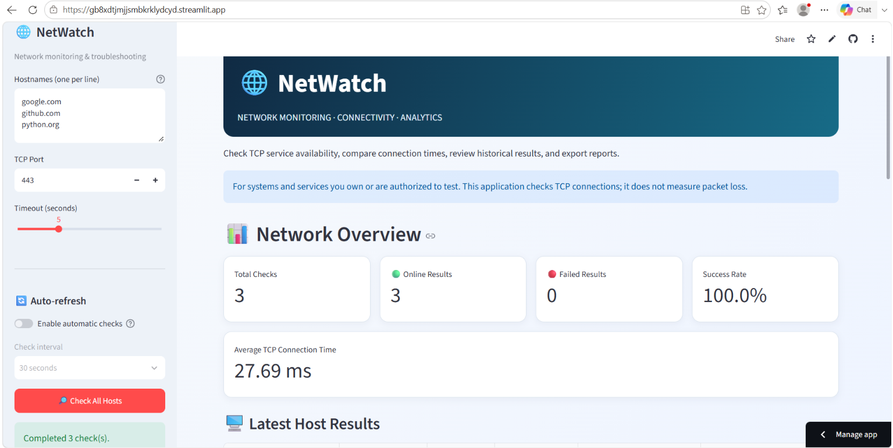
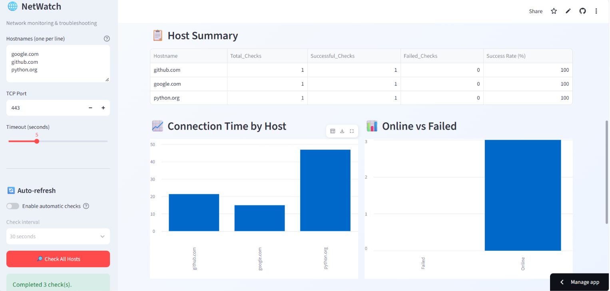
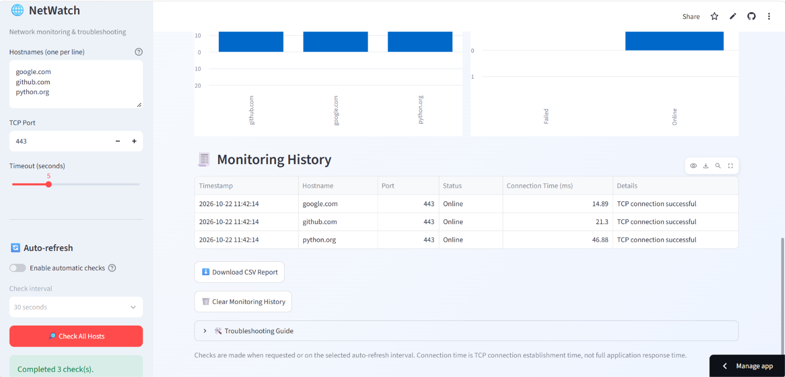

# 🌐 NetWatch — Network Monitoring and Troubleshooting System

NetWatch is a Python-based web application that checks TCP service connectivity across multiple hosts. It provides connection-time measurements, monitoring history, network analytics, and downloadable CSV reports through an interactive Streamlit dashboard.

## 🚀 Live Demo

**Try NetWatch:** https://gb8xdtjmijsmbkrklydcyd.streamlit.app

## ✨ Features

* **Multi-Host Connectivity Checks:** Test multiple hostnames using a selected TCP port.
* **Connection-Time Measurement:** Measure the time taken to establish a TCP connection.
* **Network Overview:** View total checks, successful connections, failed connections, and success rate.
* **Host Summary:** Compare connectivity results for individual hosts.
* **Interactive Charts:** Visualize connection-time measurements and connection statuses.
* **Monitoring History:** Review previous test results.
* **CSV Report Export:** Download monitoring results for further analysis.
* **Auto-Refresh:** Run checks at a selected interval while the application is active.
* **Troubleshooting Guide:** Review suggestions for common connection problems.

## 🛠️ Technologies Used

* Python
* Streamlit
* Pandas
* Socket Programming
* Git and GitHub
* Streamlit Community Cloud

## ⚙️ Run Locally

### 1. Clone the repository

```bash
git clone https://github.com/Sravani-0605/NetWatch.git
cd NetWatch
```

### 2. Create a virtual environment

```bash
python -m venv .venv
```

### 3. Activate the virtual environment

**Windows PowerShell:**

```powershell
.venv\Scripts\Activate.ps1
```

### 4. Install dependencies

```bash
pip install -r requirements.txt
```

### 5. Start the application

```bash
python -m streamlit run app.py
```

The application will open in your browser.

## 📊 How It Works

1. Enter one or more hostnames in the sidebar.
2. Select the TCP port and connection timeout.
3. Click **Check All Hosts** to run the connectivity tests.
4. Review connection statuses, connection times, analytics, and charts.
5. Download the monitoring history as a CSV report if needed.

## 🎯 Use Cases

* Checking whether a TCP service is reachable.
* Comparing TCP connection establishment times across hosts.
* Reviewing connectivity test history.
* Exporting results for basic network troubleshooting and analysis.

## ⚠️ Limitations

* The application tests TCP connectivity to the selected port; it does not measure packet loss.
* Connection establishment time is not the same as full application response time.
* Results depend on network conditions, DNS resolution, firewall rules, and the target service.
* Monitoring runs when requested or according to the selected auto-refresh interval while the application is active.
* Use the application only on systems and services you own or are authorized to test.

## 👩‍💻 Author

**Sravani Kakollu**

GitHub: https://github.com/Sravani-0605
## 📸 Project Screenshots

### 1. Network Monitoring Dashboard



### 2. Network Analytics



### 3. Monitoring Results


